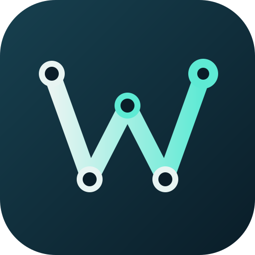

  

# Workday MCP for Claude Desktop (local install)

Ask Claude about your Workday data in plain English, signed in as yourself.

**Website:** <https://ppoinha.github.io/LocalWorkdayMCP/> (features, examples, install walkthrough and security overview).

This repository contains the **installer and documentation** for Workday MCP, a [Model Context Protocol](https://modelcontextprotocol.io) server for the Workday REST API. The server source code is not published here.

> **Status: early testing.** Today it is installed locally, by each person, on their own **Windows** computer, through **Claude Desktop**. A central deployment for a whole organization is planned.

## Get started

1. **Read the [installation guide](docs/installation-guide.md).** It walks through registering your own Workday API Client (your own client ID and secret, nothing shared), installing the extension and signing in.
2. **Download the install file** `workday-mcp-<version>.mcpb` from the [Releases page](https://github.com/ppoinha/LocalWorkdayMCP/releases) (under *Assets*).
3. In Claude Desktop open **Settings > Extensions > Advanced settings > Install Extension**, pick the file, fill in the form, and use it from the **Chat** tab.
4. Try the [example questions](docs/example-questions.md).

Port 3000 must be free on your PC while you sign in. The guide explains why and how to check.

## How access works

- The **Workday API Client you register** limits which parts of Workday the server can reach (its scopes).
- **You sign in with your own Workday account**, so Workday's security still decides what you see. Claude never gets more access than you have.
- The client secret and tokens stay on your computer and never reach the model. There is no "call any URL" tool, and the tools that change data are off by default.

## What works today

| Client | Status |
|---|---|
| Claude Desktop on Windows (Chat tab) | Supported |
| ChatGPT, Microsoft Copilot Studio | Need the planned remote version |

## Feedback

Please open an [issue](https://github.com/ppoinha/LocalWorkdayMCP/issues) with what you asked, what you expected and what happened. Do not include client secrets, tokens or real employee data.

## License

Source-available, **not open source**. Free for non-commercial use under the [PolyForm Noncommercial License 1.0.0](LICENSE); commercial use is not permitted. Copyright (c) 2026 ppoinha.
