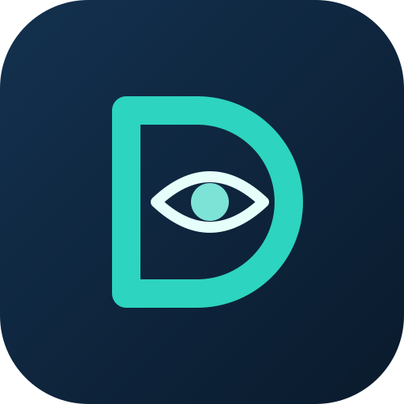

  

# Example questions

What you can ask once DaySight MCP is installed and you have signed in, and the charts and dashboards your assistant can draw from the answers. All names, numbers and answers below are **illustrative sample data** ("Northwind Demo Co.") that show the shape of the answers. The assistant words its replies itself, so the real wording and formatting will differ. Workday decides what you are allowed to see, so some questions return less (or nothing) for people without the matching permissions.

> **30-day trial.** The download works for 30 days for each Workday tenant; after that a licence key is needed (see the [installation guide](installation-guide.md#10-troubleshooting)).

> **Privacy and safety.** Use DaySight MCP with **Claude Enterprise**, which does not use your conversations to train models. Whatever your assistant retrieves is sent to the AI provider as part of the conversation.

## Workforce analytics

Switch on **Allow Workday Query Language (WQL) reports** in the extension settings. Answers are summaries only: no names, no individual pay, groups under three people are never shown, and pay figures need groups of five or more. Workforce analytics is still being checked against real tenants, so compare the first figures with a Workday report you trust.

**"Show the board scorecard."**
> Headcount 4,812 (up 2.7% on a year ago), 4,655 FTE. 612 hires and 487 exits in the last 12 months, turnover 10.1%. Women in leadership 38%. Standing out: Customer Support has the highest turnover, and 9% of Finance is within five years of retirement age.

**"Headcount, hires and exits by quarter for the last two years."**
> Headcount grew from 4,402 to 4,812 over eight quarters. Hiring peaked at 181 in Q2 last year, and exits held steady near 120 a quarter.

**"Turnover by function for Germany only."**
> Germany has 642 active workers. Customer Support 17.9%, Sales 12.4%, Operations 9.1%, Engineering 7.2%, Finance 5.1%. Groups under three people are rolled into Other.

**"Which locations have the highest voluntary turnover?"**
> Austin 9.8%, Munich 8.6% and Chicago 7.9%. The other 11 locations are below 6%.

**"Where are people aged 55 or older concentrated?"**
> Finance (31% of the function) and Operations (24%). Together they hold 41% of everyone aged 55 or older.

**"What does each of the CEO's direct reports' organization cost, and how big is it?"**
> 7 organizations. The largest has 1,420 people and a base pay cost of $98M. Leaders appear as their organization plus a short code, never by name.

**"How does women's share in leadership compare across functions?"**
> Finance 52%, Marketing 47%, Sales 39%, Operations 34%, Engineering 27%. The company average is 38%.

**"Give me the HR business partner view for the Munich location."**
> Munich: 318 active workers, 24% women, average tenure 5.2 years, 11 exits in the last 12 months and an average span of control of 7.4.

**"Which groups are growing fastest, and which are shrinking?"**
> Customer Support grew 9.4% and Engineering 6.1% over 12 months. Operations shrank 2.3%. Smaller groups are rolled into Other.

## Dashboards and charts

Ask your assistant to draw any answer, or to build a whole dashboard for an audience. Your assistant draws the charts from the answers it gets from Workday, and you can refine them in the same conversation.

- "Build a one-page workforce dashboard for the board."
- "Chart headcount by quarter for the last two years."
- "Show turnover by function as a bar chart and highlight the highest."
- "Plot women in leadership by function against the company average."
- "Make a dashboard for the Munich location to share with its leadership team."
- "Add a cost view for finance: base pay cost by function and cost per FTE."

See sample charts and a sample dashboard on the [website](https://daysight.dev/examples.html).

## Reports

**"Build the workforce report as a PDF."** (also needs **Allow workforce reports (PDF)**)
> Created a 24-page workforce report in your DaySight MCP Reports folder: 21 sections included, 2 left out because the data was missing, each with the reason.

**"What can you do with my Workday?"**
> Lists the tools, switches, ready-made views and privacy rules that are active in your install.

## About your team and the wider Workday areas

Each area needs its scope on your API Client (see the installation guide).

**"Who reports to me?"**
> You have 4 direct reports: Maya Chen (Senior Analyst), Luis Ortega (Analyst), Priya Nair (Analyst), and Tom Becker (Associate Analyst).

**"How much vacation do I have left this year?"**
> Annual Leave: 11.5 days available. Your next scheduled entry is 3 days in December.

**"Show open job postings in Finance."**
> 2 postings: Senior Financial Analyst (Chicago) and Accounting Manager (Remote), with their posting dates.

**"What goals do I have open this year?"**
> 3 goals: Launch the quarterly forecast model (in progress), Document the month-end close (not started), Mentor one analyst (in progress).

**"What compensation scorecards exist?"**
> 2 scorecards: FY25 Merit and FY25 Bonus, each with its measures and weights.

Tip: ask in the **Chat** tab of Claude Desktop, and if the assistant says it is not signed in, ask it to call `workday_login`.
